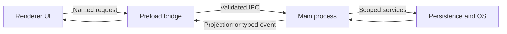

# Electron 架构与工程

CP1 优先阅读现有应用入口、preload、IPC、Renderer、测试和打包配置。多版本并存时，以当前目标分支实际依赖和可执行文件为准。记录 `ARCHITECTURE.md` 或已有等价文件，包含边界、重要接口、替代方案、验证方式和技术风险。

- **Main** 管理窗口和应用生命周期、菜单、托盘、通知、文件与 OS 集成及受控服务。为各能力定义调用边界和拒绝路径。异步或重试操作说明清理、取消、幂等和恢复策略。
- **Preload** 使用 `contextBridge` 暴露最小的具名、类型化接口。定义请求、结果、错误与事件清理。按窗口或来源限制可用能力，并在 Main 再核验参数、来源和授权。
- **Renderer** 运行界面状态、输入校验与导航。默认启用 context isolation 和 sandbox，禁用不可信渲染器的 Node integration。远程内容与本机能力隔离。分别评估导航、新窗口、深链、权限提示和文件选择。
- **数据与服务** 决定持久化位置、数据权威、迁移、鉴权、日志与隐私。处理断连与冲突，保留可证明的结果。测试至少覆盖受影响的允许路径、拒绝路径及运行态。
- **分发** 按确切要求列出 Windows、macOS 和 Linux 范围。记录打包、原生依赖、安装与卸载、签名、公证和更新策略。每个平台使用与其发布目标匹配的实测证据。

将引入新权限、更换进程边界、改变数据契约等重大决策送审。保持现有仓库架构中适用的部分，并用实际测量解决性能问题。

[Electron 进程模型](https://www.electronjs.org/docs/latest/tutorial/process-model) · [IPC](https://www.electronjs.org/docs/latest/tutorial/ipc) · [安全](https://www.electronjs.org/docs/latest/tutorial/security) · [应用分发](https://www.electronjs.org/docs/latest/tutorial/application-distribution)
